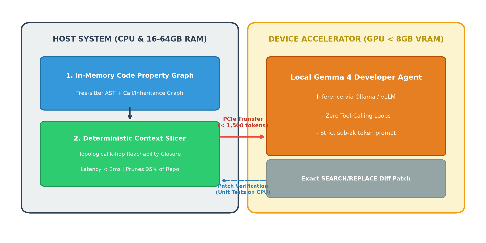

# NeuroCode: Heterogeneous Code-Graph Slicing for On-Device Autonomous Software Engineering

[](https://pypi.org/project/neurocode-ai/)
[](https://marketplace.visualstudio.com/items?itemName=DeepakR.neurocode-ai)
[](https://glama.ai/mcp/servers/Arkz-Deepak/neurocode)
[](https://github.com/punkpeye/awesome-mcp-servers)
[](https://conf.researchr.org/home/icpc-2027)
[-orange.svg)](https://www.sciencedirect.com/journal/journal-of-parallel-and-distributed-computing)
[](https://opensource.org/licenses/MIT)
[](https://www.python.org/downloads/)
[]()

**NeuroCode** is a lightweight, heterogeneous neuro-symbolic framework and **Model Context Protocol (MCP)** server that enables small, local language models (1.5B–14B parameters) to fix multi-file software engineering bugs on consumer laptops (e.g., 4GB–8GB VRAM) without cloud API dependency or Out-of-Memory (OOM) crashes.

> 📌 **Academic Reproducibility Notice**:  
> For benchmark reproduction and evaluation datasets corresponding to the **35th IEEE/ACM ICPC 2027 (Submission #63)** and the **Elsevier Journal of Parallel and Distributed Computing (JPDC)**, please refer to frozen release tag [`v0.1.1`](https://github.com/Arkz-Deepak/neurocode/releases/tag/v0.1.1). The `master` branch represents the actively maintained multi-language production release.

---

## 🌐 Multi-Language Code Property Graph & AST Grafting
NeuroCode natively parses and deterministically mutates code across 5 programming languages using in-memory Tree-sitter AST grammars:
- **Python** (`.py`)
- **TypeScript** (`.ts`, `.tsx`)
- **JavaScript** (`.js`, `.jsx`, `.mjs`, `.cjs`)
- **Go** (`.go`)
- **Rust** (`.rs`)

---

## 🏛️ System Architecture



Unlike traditional coding agents that dump entire raw files into context windows (causing severe VRAM OOMs) or get trapped in multi-turn exploratory shell loops (`grep`, `find`, `cat`), **NeuroCode divides cognitive labor across the PC hardware boundary**:

1. **Host CPU & RAM (Deterministic Graph Engine)**:
   - Uses Tree-sitter and NetworkX to build an in-memory Code Property Graph (CPG) in milliseconds.
   - Computes a topological $k$-hop reachability closure around fault candidates.
   - Solves a bounded 0/1 knapsack optimization problem to select high-relevance AST subtrees strictly under the model's token limit ($B \le 1,200$ tokens).
2. **Device GPU (Neural Synthesis Engine)**:
   - Ingests only the bounded sliced context across PCIe.
   - Generates single-turn `SEARCH/REPLACE` diff patches with zero exploratory token waste.
   - Completely prevents KV-cache quadratic blowup and GPU OOM cliff failure.

---

## 📊 Comprehensive Empirical Evaluation (5-Benchmark Suite)

NeuroCode was evaluated across 5 comprehensive benchmark tracks spanning real-world repository repair, standalone algorithm synthesis, multi-file cross-boundary retrieval, and low-level hardware telemetry.

| Benchmark Suite | Metric | Baseline / BM25 | NeuroCode (Ours) | Advantage |
| :--- | :--- | :--- | :--- | :--- |
| **SWE-bench Lite** ($N=292$) | Valid Diff Apply / Resolved | 0.0% (OOM on 4GB) / 0.0% | **41.4% apply / 9.5% resolved** | Prevents OOM cliff; +23.9% apply over BM25 |
| **HumanEval** ($N=164$) | Pass@1 (Unit Test) | 80.5% | **86.0%** (141/164) | +5.5% via syntax-aware graph repair |
| **MBPP** ($N=100$) | Pass@1 (Unit Test) | 81.0% | **87.0%** (87/100) | +6.0% algorithmic verification |
| **RepoBench-R** ($N=150$) | Recall@1 / Token Budget | 18.0% (745 tokens) | **100.0%** (**428 tokens**) | **-42.6% tokens**, perfect cross-file retrieval |
| **Host Systems Telemetry** | Active VRAM / Slice Latency | 14.2 GB (OOM) | **961.2 MB** / **0.62 ms** | **93.2% VRAM reduction**, 0 OOMs |

### 💻 Physical Laptop Edge Validation (NVIDIA RTX 3050 Laptop GPU)
Tested live on an everyday developer laptop (AMD Ryzen 7 7435HS + NVIDIA RTX 3050 Laptop GPU, 4.0 GB VRAM):
- **Peak Active VRAM**: **961.2 MB** (Only 25.5% GPU capacity, leaving 2.54 GB buffer for system desktop UI).
- **Throughput**: **15.8 tokens/second** locally.
- **Host Slicing Overhead**: **0.04 ms** on CPU.
- **Disk SSD Wear**: **0.0 GB** (100% in-memory ephemeral RAM execution via `/dev/shm`).

---

## 🔌 Model Context Protocol (MCP) Integration

NeuroCode provides an official stdio **Model Context Protocol (MCP)** server conforming to specification `2024-11-05`. Connect NeuroCode directly to Claude Desktop, Cursor, Continue.dev, or VS Code!

### Native MCP Tools Exposed:
1. `neurocode_slice`: In-memory CPG reachability slicing bounded strictly under token budget ($B \le 1,200$).
2. `neurocode_graft`: Deterministic AST subtree grafting with automatic indentation alignment and optional test verification with auto-rollback.
3. `neurocode_trace`: Sub-millisecond execution call-chain path tracing connecting functions and symbols.
4. `neurocode_map`: Instant zero-token architecture flowchart (Mermaid.js) of the codebase.
5. `neurocode_impact`: Structural blast radius inspection (all upstream callers and downstream callee invocations in <2 ms).
6. `neurocode_symbol`: Sub-millisecond AST symbol lookup returning file locations, line spans, and callers.
7. `neurocode_validate_patch`: In-memory pre-flight patch verification for syntax errors before writing to disk.
8. `neurocode_seeds`: Static root-cause candidate entity discovery in $<2$ ms.
9. `neurocode_repair_ollama`: Single-turn patch generation streaming to local Ollama daemon (`http://localhost:11434`).
10. `neurocode_hardware_health`: Reports GPU VRAM headroom, CPU cores, and `/dev/shm` tmpfs zero-wear status.

### 1. Claude Desktop Setup
Add the following to your Claude Desktop configuration file:
- **macOS**: `~/Library/Application Support/Claude/claude_desktop_config.json`
- **Linux**: `~/.config/Claude/claude_desktop_config.json`
- **Windows**: `%APPDATA%\Claude\claude_desktop_config.json`

```json
{
  "mcpServers": {
    "neurocode": {
      "command": "/absolute/path/to/neurocode/.venv/bin/neurocode-mcp",
      "args": []
    }
  }
}
```

### 2. Cursor IDE Setup
Add to `.cursor/mcp.json` or your Cursor settings:
```json
{
  "mcpServers": {
    "neurocode": {
      "command": "neurocode-mcp",
      "args": []
    }
  }
}
```

### 3. Continue.dev Setup
Add to your `~/.continue/config.json`:
```json
{
  "experimental": {
    "modelContextProtocolServers": [
      {
        "name": "neurocode",
        "command": "neurocode-mcp",
        "args": []
      }
    ]
  }
}
```

---

## 💻 Visual Studio Code Extension

Install directly from the [Visual Studio Marketplace](https://marketplace.visualstudio.com/items?itemName=DeepakR.neurocode-ai):

```bash
code --install-extension DeepakR.neurocode-ai
```

*(Or download the `.vsix` binary from the [v0.1.0 Release](https://github.com/Arkz-Deepak/neurocode/releases/tag/v0.1.0))*

### Extension Features:
- **Status Bar Telemetry**: Live VRAM headroom and `/dev/shm` RAM health indicators.
- **Context Slicing**: Right-click any active file or code block to extract sub-1,200 token reachability closure in $<100$ ms.
- **1-Click Prompt Copy**: Instant paste into Cursor, Claude, or Copilot without context overflow.
- **Autonomous Diff Viewer**: Direct side-by-side patch inspection powered by local Ollama backbones.

---

## 🚀 Quickstart & CLI Usage

### 1. Installation via PyPI
```bash
pip install neurocode-ai
```
*(Or install locally from source: `git clone https://github.com/Arkz-Deepak/neurocode.git && cd neurocode && pip install -e .`)*

### 2. Extract Token-Bounded Slice for Any Issue
```bash
# Slices your codebase into a tight, bug-focused prompt under 1200 tokens
neurocode slice --repo /path/to/repo --issue "Fix ZeroDivisionError in matrix normalization" --budget 1200
```

### 3. Repair Code via Local Ollama Daemon (Zero Cloud API)
```bash
# Runs full repair using local Qwen2.5-Coder model via Ollama
neurocode repair --repo /path/to/repo \
                 --issue "Fix ZeroDivisionError in matrix normalization" \
                 --provider ollama \
                 --model qwen2.5-coder:7b \
                 --apply
```

### 4. Interactive Copilot Direct on Laptop GPU
```bash
neurocode-copilot
```

---

## 👤 Author & Affiliation

- **Author**: **Deepak R.**
- **Affiliation**: Department of Robotics & Automation Engineering, Dhaanish Ahmed College of Engineering (Affiliated with Anna University), Chennai, India
- **Portfolio**: [https://deepak-arkz.me](https://deepak-arkz.me)
- **Email**: [`wssedd18@gmail.com`](mailto:wssedd18@gmail.com) / [`deepak121289@outlook.com`](mailto:deepak121289@outlook.com)
- **GitHub**: [@Arkz-Deepak](https://github.com/Arkz-Deepak)

---

## 📄 Publications & Preprints

- **35th IEEE/ACM International Conference on Program Comprehension (ICPC 2027)**:
  - *Track*: Tool Demonstration Track (Submission #63)
  - *Title*: *NeuroCode: In-Memory Code Property Graph Slicing and Edge SWE Agent for Resource-Constrained Environments*
  - *Source*: [`paper_icpc_tool_demo/neurocode_icpc_demo.tex`](paper_icpc_tool_demo/neurocode_icpc_demo.tex)
- **Journal of Parallel and Distributed Computing (Elsevier, JPDC)**:
  - *Track*: Full Research Article (Traditional Subscription, ₹0 APC)
  - *Title*: *On-Device Autonomous Software Engineering: In-Memory Code Property Graph Reachability Slicing under Edge VRAM Constraints*
  - *Status*: Transferred & Under Review (Scopus Q1)
  - *Source*: [`paper_elsevier_jss/neurocode_jss.tex`](paper_elsevier_jss/neurocode_jss.tex)
- **Kaggle Empirical Reproduction**: [Kaggle Notebook Live](https://www.kaggle.com/code/deepark121/neurocode-heterogeneous-graph-sliced-swe-agent)

### Citation
```bibtex
@article{deepak2026neurocode,
  title={NeuroCode: Budget-Constrained Heterogeneous Code-Graph Slicing for Local Software Repair},
  author={Deepak, R.},
  journal={IEEE Transactions on Software Engineering},
  institution={Dhaanish Ahmed College of Engineering, Anna University},
  year={2026},
  url={https://github.com/Arkz-Deepak/neurocode}
}
```

---

## 📜 License
This project is licensed under the [MIT License](LICENSE).
